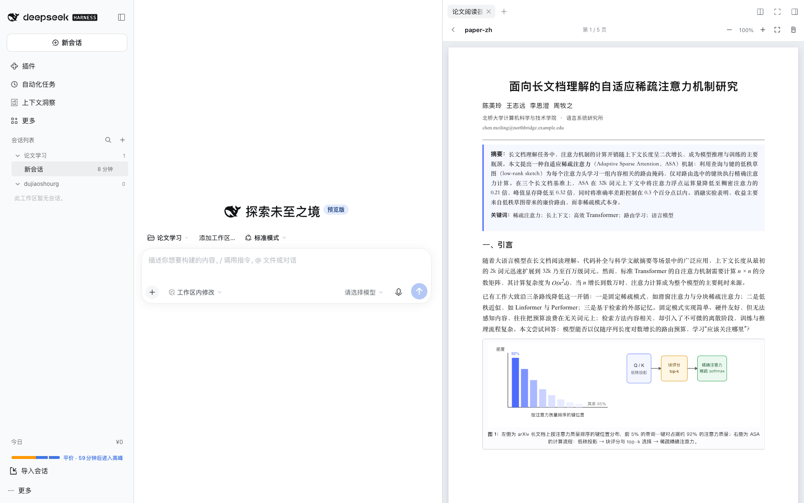

# dsh-paper-reader — 论文阅读器 / Paper Reader

A right-sidebar paper reader plugin for the DeepSeek Harness Web GUI. Upload a
PDF and read it with the original layout, fonts and images intact; select any
text to **highlight it**, **add a note**, or **ask about it in the chat** with a
default prompt written in the UI's own language.

## Features

- **从右侧边栏进入**：右侧边栏的 `+` → 指南页（guide）里的 **论文阅读器** 卡片；
  也可以在该面板里保留一个常驻标签页。
- **上传论文**：文件选择器 + 拖拽上传；论文保存在浏览器 IndexedDB
  （`dsh-paper-reader` 数据库），刷新页面、切换会话、重启应用后仍在。
- **完整保留原始排版**：用内置 PDF.js（6.3.289，随插件本地分发，不依赖 CDN）
  把 PDF 渲染成 canvas，字体、图片、矢量图、颜色与分页位置均按原始 PDF 呈现；
  同时生成可选中的透明文本层（text layer），因此文字是真选中，而不是截图。
- **划词悬浮菜单**：选中文字后在选区下方浮出三个操作
  **高亮 / 添加笔记 / 在会话中提问**。
  - 高亮按页保存，缩放/滚动/重新打开后仍精确贴合原文；
  - 笔记与高亮、页码、原文引文一起保存，右侧“笔记与高亮”面板可跳转回原文；
  - “在会话中提问”把默认提问 prompt 写入当前会话的输入框：
    - 中文界面 → 中文 prompt（含论文标题、页码、所选原文、待填问题）；
    - 英文界面 → 英文 prompt；
    - 语言跟随 DSH 界面语言（`ctx.locale` 的活动 locale），可在设置中切换。
- 阅读器工具栏：返回论文库、页码、缩放（− / 百分比 / + / 适应宽度）、
  笔记面板；阅读状态按会话记忆最近打开的论文。

## 从 GitHub 使用 / Clone and verify

本项目是 **DeepSeek Harness 插件**，需要先安装 DSH；它不是独立桌面应用。
运行时代码无需构建。开发 GUI 辅助脚本面向 macOS 的标准 DSH 安装路径，
并依赖已有的 `desktop` profile。请先按下文手动安装，不要在不了解现有
profile YAML 布局时运行 `scripts/install.sh`（该脚本假定文件末尾为 insert 列表）。

```bash
git clone https://github.com/yue29033-ai/dsh-paper-reader.git
cd dsh-paper-reader
# Verification only: uses Node.js and Google Chrome installed on this machine.
# Skip this install if your selected DSH profile already includes Playwright.
npm install --no-save playwright
SKIP_GUI=1 bash tests/run.sh
```

测试优先读取项目本地的 Playwright，也支持 `DSH_HOME` 和 `DSH_PROFILE`
指定 DSH 中已有的安装。完整 GUI 验收需要先按下文安装插件并准备开发实例；
`tests/run.sh` 默认会尝试启动该实例。



## Install (into a DSH profile)

This package is a DSH **bundle**: `dsh.bundle.patch` inserts one Host row that
serves the vendored PDF.js assets, and `dsh.client` declares the browser half.

```bash
# local link install (development)
mkdir -p ~/.dsh/profiles/<profile>/node_modules
ln -sfn /absolute/path/to/dsh-paper-reader ~/.dsh/profiles/<profile>/node_modules/dsh-paper-reader
# then merge the following into the appropriate insert section of cordis.patch.yml:
# (this is a YAML fragment, not text to append blindly to the end of the file)
#   - insert:
#       - id: paper-reader
#         name: 'dsh-paper-reader'
```

The running Host recomposes the profile (HMR) and pushes the plugin to the open
Web page; reload the page if the guide card is not visible yet. Uninstall by
removing the mount row and the symlink.

## Usage

1. Open the right sidebar (conversation-header corner button, `Shift+Meta+B` on
   web/macOS) and use the tab strip `+`; pick **论文阅读器** on the guide page.
2. **上传论文** → choose a PDF. It appears in the library list.
3. Click a paper to open it. Scroll, zoom, select text.
4. Select text → floating menu:
   - **高亮** — saved immediately;
   - **添加笔记** — quote + note, saved with a highlight;
   - **在会话中提问** — the localized prompt lands in the chat composer;
     add your question and send.
5. Header **笔记与高亮** badge opens the annotation list; click a row to jump to
   its page, or delete it there.

## Architecture

```
lib/client.js          right-sidebar tab type + guide card + body registration;
                       Session core face (composer insertion, vendor base)
lib/client.app.js      integration shell: library↔reader, zoom, floating menu
                       placement, highlight/note/ask flows, notes panel, toasts
lib/client.library.js  IndexedDB paper store + upload/library UI
lib/client.viewer.js   PDF.js page stack, text layer, selection geometry
lib/client.annotations.js  annotation store (localStorage) + HighlightLayer,
                       SelectionMenu, NoteComposer, NotesPanel, buildAskPrompt
lib/index.js           Host half: serves /paper-reader/vendor/* (PDF.js) and
                       owns nothing else
vendor/                PDF.js 6.3.289 (vendor/PDFJS-LICENSE), plus fonts,
                       cmaps, wasm and ICC assets with their own license files
```

Client code is hand-written plain JS in the DSH client-module format
(`window.__ModuleLoader__.load({ id, chunk?, factory(require) })`), with
lazily-loaded sibling chunks via `require.async('./client.<name>.js')` — no
build step, no bundler, only React from the frozen platform table. Styling uses
the host theme tokens (`--dsw-alias-*`); UI copy is per-chunk `{zh, en}`
dictionaries driven by the active locale.

## Verification (results on this machine)

- `for file in lib/*.js; do node --check "$file" || exit; done` — all bundles are valid classic scripts.
- **Standalone harness: 56/56 checks pass** — `node harness/serve.mjs` →
  <http://127.0.0.1:7812/> (fake module loader with the real
  registration/require semantics + real React 18 + real PDF.js);
  `tests/harness.spec.mjs` drives viewer / annotations / library / full-app
  scenarios with Playwright, screenshot evidence in `tests/screenshots/`.
- **Real right-Sidebar GUI E2E: 30/30 checks pass** (15 × zh + en) against an
  isolated DSH host (`scripts/dev-gui.sh start`, port 54001, same plugin list as
  the desktop profile, real right sidebar + real tab registry + real chat
  composer):
  - zh + en: guide card → reader tab → upload `fixtures/paper-zh.pdf` (5 pp) /
    `paper-en.pdf` (3 pp) → canvas pages render with original layout, fonts,
    figures and tables; selectable text layers (900+ spans), page indicator,
    zoom 100% → 110% re-render;
  - selection → floating menu with exactly 高亮 / 添加笔记 / 在会话中提问
    (en: Highlight / Add note / Ask in chat), positioned under the selection;
  - highlight persists and realigns with the text; note saves and lists in the
    笔记与高亮 panel (page / quote / note, jump + delete); header badge updates;
  - ask-in-session writes a **Chinese prompt in the zh UI** and an **English
    prompt in the en UI** (title + page + quote + 我的问题 / My question) into
    the live chat composer;
  - reload persistence: paper list (IndexedDB), the opened paper, its
    annotations and the last-opened-paper memory survive a page reload;
  - corrupt PDF → localized error block, app stays alive;
  - `/paper-reader/vendor/pdf.mjs` (860 KB) + `pdf.worker.mjs` (2.4 MB) served
    from the real page origin by the Host half.
- **One command for both matrices:** `tests/run.sh` (`SKIP_GUI=1` for the
  chunk-level harness only, `GUI_ONLY=1` for the GUI gate; it starts the
  isolated dev host on demand). Screenshots: `docs/screenshots/` and
  `tests/screenshots/`.

## Limitations

- PDF is the only paper format (canvas rendering is what guarantees "no layout
  lost"; reflowing formats would not).
- Scanned/image-only PDFs render perfectly but have no selectable text, so the
  selection menu cannot appear on them.
- Uploads and annotations live in the browser profile (IndexedDB/localStorage),
  not in the workspace; they are per-browser.
- The plugin is installed as a local (linked) package in this profile; code
  changes require a page reload (the Host serves bundle bytes live).
